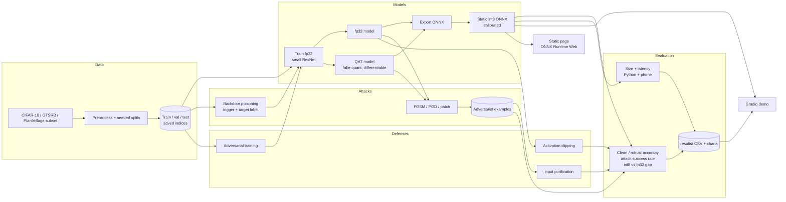

# PLAN.md: Secure TinyML

Attacking and defending quantized image models. A study platform that trains small image classifiers, compresses them (int8 quantization), then measures how adversarial patches, FGSM/PGD and backdoors behave on the full-precision model versus the quantized one. It adds three cheap defenses (adversarial training, input purification, activation clipping) and checks whether they still fit a small on-device budget. A Gradio demo lets a visitor add a patch to an image and compare predictions, and a browser page runs the int8 model with ONNX Runtime Web on a phone.
Budget: 6 weeks of evenings and weekends, free compute (Kaggle/Colab GPU), free hosting, laptop and phone only.
Honest framing: this is a **study on small models and small images**, not a claim about production edge devices. The Raspberry Pi test from the original idea is replaced by a browser/phone test (no extra hardware), so latency numbers are for one phone and one browser, not for microcontrollers. Attack success is measured, not assumed.

## Scope

| Area | Decision |
|---|---|
| Datasets | **CIFAR-10** (main, fast: 32 px, 10 classes). **GTSRB** (traffic signs, resized to 32 px, 43 classes; the realistic patch and backdoor story, e.g. a sticker on a stop sign). **PlantVillage** (leaf disease, a subset of about 10 classes at 64 px; the "agriculture on an edge device" story). Build CIFAR-10 end to end first; GTSRB second; PlantVillage only if time allows. |
| Licences | See the table in section 5. Short version: none of the three has one clean, authoritative statement I could verify, so **raw data is never redistributed**, the demo ships a few small example images only after the terms are re-checked, and the README says what is unverified. |
| Models | Small ResNet-style CNN (about 0.3–1M parameters) for 32 px; the same net with one extra stage for 64 px. Batch norm is fine here (no FL or DP). Trained from scratch, no pretrained backbones. Small enough to train in minutes on a free GPU. |
| Quantization | **One quantized format for everything: ONNX Runtime static int8 (QDQ), calibrated on a few hundred training images.** The same `.onnx` file is evaluated in Python and loaded in the browser, so the model attacked is the model shipped. Also **PyTorch QAT** (quantization-aware training, fake-quant) as the differentiable stand-in for gradient attacks. |
| TFLite | **Optional stretch, not on the critical path.** The brief lists TFLite; converting PyTorch to `.tflite` goes through Google's PyTorch converter, which has been renamed recently (ai-edge-torch to litert-torch) and which I could not confirm works on Windows. If tried, it runs on Colab (Linux), once, as a cross-check that results do not depend on the int8 toolchain. |
| Attacks | **FGSM and PGD** (L-infinity, written by hand in about 20 lines each so the maths is visible), **adversarial patch** (a square learned by gradient ascent, placed at random positions), **backdoor** (data poisoning with a small trigger, 1–5% of training data, targeted label). Adversarial Robustness Toolbox (ART) is used as a cross-check and for backdoor/poison helpers, not as the only implementation. |
| Threat settings | (1) **White-box on fp32**, then test the same examples on int8 (transfer). (2) **White-box on the QAT model** (gradients through fake-quant with a straight-through estimator). (3) **Black-box on int8** (query only, simple score-based or transfer). Real int8 kernels have no useful gradient, so how to attack a quantized model is itself a finding. |
| Defenses | **Adversarial training** (PGD, a few steps, on the small net), **input purification** (JPEG-style compression, median/bilateral filter, bit-depth reduction; cheap and model-free), **activation clipping** (clamp activations at calibrated bounds, which also helps int8 range). Each is measured for robust accuracy, clean accuracy and on-device cost. Defenses are tested against **adaptive** attackers where cheap to do so (the attacker knows the purifier), otherwise the result is labelled "non-adaptive". |
| Backdoor detection | Out of scope as a full project. One simple check: activation-clustering via ART, or a spectral-signature check, on the poisoned set, to see whether it finds the poison. |
| Device cost | Model size (KB), int8 vs fp32 latency in Python (CPU) and in the browser on one phone (ONNX Runtime Web, WASM backend first, WebGPU only if it works), accuracy on the device versus on the laptop. |
| Demo | **Gradio** app: upload an image or pick an example, choose a patch (pre-computed) and position, see fp32 vs int8 vs defended predictions side by side. Runs on CPU from exported ONNX models. A second static page (plain HTML + ONNX Runtime Web) is the phone test, hosted as static files. |
| Secrets | None needed. Datasets download without tokens (Kaggle API token only if the Kaggle CLI route is used for PlantVillage, kept in an env file that is gitignored). `.env.example` holds names only. |
| Out of scope | Real microcontrollers or Raspberry Pi, physical-world printed patches, model extraction and membership inference, LLM or detection models, certified defenses, models larger than a small ResNet. |

## 1. Architecture



- **Preprocess and splits**: downloads, resizes, and saves fixed train/val/test indices so every experiment sees identical data. Class balance and quality problems go in a data report.
- **Train**: one small ResNet per dataset, fixed seeds, logged curves. The reference model for everything else.
- **Quantization**: static int8 via ONNX Runtime (what ships), and QAT in PyTorch (what gradient attacks can differentiate through). Comparing the two against the fp32 model is the core question: does compression change how fragile the model is?
- **Attacks**: FGSM (one gradient step), PGD (many small steps, projected back into an allowed box), patch (optimise a visible square, no size limit on pixel change), backdoor (poison training data so a trigger forces a chosen class while clean accuracy stays high). Each is a small function with a unit test.
- **Defenses**: adversarial training (train on attacked images), purification (clean the input before the model), activation clipping (limit how large a hidden activation can get). Each runs as a wrapper so the same evaluator measures all of them.
- **Evaluation**: one runner that takes (model variant, attack, defense, seed) and writes one row to a CSV. All charts come from the CSV.
- **Demo and phone page**: read exported ONNX files only; no PyTorch in the hosted app.

**Metrics**
- **Clean accuracy** and **robust accuracy** (accuracy under attack) at stated strengths (e.g. eps 2/255, 4/255, 8/255 for L-infinity; patch covering 4–10% of the image).
- **Attack success rate** (for patch and backdoor: fraction pushed to the attacker's target class) and, for backdoors, clean accuracy drop.
- **Transfer rate**: fraction of fp32 adversarial examples that also fool the int8 model.
- **Int8 gap**: accuracy and robustness difference between fp32 and int8.
- **Cost**: model size in KB, median latency (Python CPU, phone browser), number of extra operations a defense adds.
- **Variance**: 3 seeds for training, mean with 95% confidence intervals (t-interval over seeds); attack randomness (random starts, patch positions) reported separately.

## 2. Compute budget

| Part | Where | Size |
|---|---|---|
| CIFAR-10 / GTSRB training (small ResNet) | Kaggle or Colab GPU | A few minutes per model. |
| Adversarial training | GPU | About 3–8x the cost of normal training (several attack steps per batch), so use few PGD steps and fewer epochs. |
| Patch optimisation | GPU | Minutes per patch; keep a small set of patches. |
| PlantVillage subset | Kaggle GPU | The full set is about 54k images; use a 10-class subset at 64 px, preprocessed once to a small `.npz`. |
| ONNX export, int8 calibration, latency tests | Laptop CPU | Seconds to minutes. |
| Gradio demo, phone page | Free hosting, CPU only | Tiny ONNX models. |

Free GPU quotas change, so check your own Kaggle and Colab limits in week 1. Every run writes a CSV row and saves its model, so a lost session costs one run, not the project. Laptop GPU/RAM is unknown, so nothing assumes a local GPU.

## 3. Repo structure

```
secure-tinyml/
├── securetinyml/
│   ├── data/          # load.py (CIFAR-10, GTSRB, PlantVillage), splits.py
│   ├── models/        # resnet_small.py, qat.py, export.py (ONNX), quantize.py (int8)
│   ├── attacks/       # fgsm.py, pgd.py, patch.py, backdoor.py, art_bridge.py
│   ├── defenses/      # adv_train.py, purify.py, act_clip.py
│   ├── eval/          # runner.py, metrics.py, report.py, latency.py
│   └── config.py      # datasets, seeds, attack strengths
├── notebooks/         # Kaggle/Colab runners (train, attack grid, TFLite stretch)
├── app/               # Gradio demo
├── web/               # static ONNX Runtime Web phone page
├── models/            # small exported .onnx files (committed selectively)
├── data/              # splits, manifest, licence notes (raw data gitignored)
├── results/           # CSVs, charts, limitations, run_meta.json
├── docs/              # technical write-up
├── tests/
├── .env.example
├── .pre-commit-config.yaml
└── README.md, PLAN.md, CLAUDE.md, LEARNING.md
```

**Keeping keys out of git**: no secret is required, but `.env` is gitignored from the first commit, `.env.example` lists names only, and `pre-commit` runs **gitleaks** on every commit. Raw datasets and large checkpoints are gitignored. CI runs `pytest` without torch (tests that need torch are skipped or use small pure-NumPy fixtures), matching the sibling projects.

## 4. Week-by-week

| Week | Goal | Done when |
|---|---|---|
| 1 | Skeleton + data + first model | Repo, pre-commit, gitleaks, CI. CIFAR-10 and GTSRB load with saved splits; licence table in the README; PlantVillage download checked. Small ResNet trained on CIFAR-10 to a sensible accuracy (about 85–90%). Kaggle/Colab quota checked. **Check: can one model be exported to ONNX and quantized to int8 with a small accuracy loss?** |
| 2 | Quantization + evasion attacks | fp32, QAT and int8 variants of the model. FGSM and PGD written and tested (an eps of 0 changes nothing; accuracy falls as eps grows). Robust accuracy for fp32 vs int8, including the transfer rate. **Decision: how to attack the int8 model (QAT surrogate vs black-box).** |
| 3 | Patch + backdoor | Adversarial patch (learned, random positions) on CIFAR-10 and GTSRB. Backdoor poisoning at 1/2/5% rates: attack success versus clean accuracy, fp32 versus int8 (does quantization keep, weaken or erase the backdoor?). ART cross-check of one attack of each type. |
| 4 | Defenses | Adversarial training, input purification and activation clipping all working behind one wrapper. Robust accuracy, clean accuracy and cost per defense. At least one adaptive-attack check on purification. |
| 5 | Demo + phone test | Gradio demo on exported ONNX models with example images. Static ONNX Runtime Web page tested on a real phone (accuracy matches laptop, latency recorded). Optional: TFLite conversion on Colab. |
| 6 | Evaluation + ship | Repeat runs for variance (3 seeds), results table, 2–3 charts, limitations section, GTSRB/PlantVillage runs filled in where time allows. Deploy, README, write-up, portfolio card. No new features. |

## 5. Risks and first checks

1. **Data access and licences.**

   | Source | Licence (checked 2026-11-18, by web search only) |
   |---|---|
   | PlantVillage | Mixed. Sources say **CC0 1.0** (original Mendeley release, per Meta-Album and a derivative repo) while a Zenodo copy and one 2026 paper say **CC BY-SA 3.0**; Kaggle copies may carry Kaggle's default terms. **Unverified**: I did not open the Mendeley or Kaggle pages. Cite Hughes & Salathé (2015). |
   | CIFAR-10 | **No authoritative licence found.** Hugging Face lists "unknown", some tables say MIT, some papers say non-commercial research only. Images were crawled from the web, so third-party rights may apply. Cite Krizhevsky (2009). Treat as research use only. |
   | GTSRB | **No official licence found.** The benchmark site asks for citation of Stallkamp et al.; a Hugging Face mirror labels it GPL-3.0, which is not the authors' statement. Research use, cite the papers. |
   | Adversarial Robustness Toolbox | MIT, hosted by LF AI & Data (confirmed by multiple sources). |
   | PyTorch, ONNX Runtime | BSD-style and MIT respectively (**from memory, not searched; confirm when installed**). |

   *Check first (week 1):* open each dataset's official page (Mendeley for PlantVillage, Toronto for CIFAR-10, the INI benchmark page for GTSRB) and copy the exact terms into the README; if any is research-only, the demo shows at most a few example images and the repo never contains the datasets. CIFAR-10 is the safe starting point: the project works without PlantVillage. Note also that PlantVillage images have uniform lab backgrounds, so results will not transfer to field photos.
2. **Compute and toolchain.** Adversarial training is several times slower than normal training. The quantization toolchain is the fragile part: ONNX int8 has no useful gradients, ART's version has to match your PyTorch, and the PyTorch-to-TFLite route is renamed and unverified on Windows. *Check first:* the week-1 export-and-quantize test, an ART install on Colab with a pinned version, and your own free-GPU quota. Fall back to ONNX only if TFLite is troublesome.
3. **Weak or misleading results.** Attacking a quantized model fairly is subtle: an attack that "fails" on int8 may only be failing because gradients were masked (a known pitfall), not because int8 is robust. Small models on tiny images may also show the int8 gap as noise. *Check first:* before any claim, run the same attack at several strengths and confirm that accuracy reaches near 0% at a large eps on fp32; compare with a black-box attack on int8 to rule out gradient masking; use 3 seeds.

**Other risks.** (a) The phone test: ONNX Runtime Web works through WebAssembly in most browsers, but WebGPU on phones is inconsistent (sources disagree), so plan for WASM and treat WebGPU as a bonus. I did not verify int8 operator coverage on the WASM backend: test it in week 1 or 2. (b) A patch that works on 32 px images may be a large fraction of the picture; report patch size as a percentage. (c) Backdoor on tiny models can be very easy; use realistic poison rates and report them. (d) Raspberry Pi constraints (RAM, no GPU, ARM CPUs) were not researched because the Pi is out of scope; phone latency is not a stand-in for it.

## 6. Simplifications

- One quantized format (ONNX int8) for evaluation and the browser; TFLite only as an optional cross-check.
- Hand-written FGSM/PGD for understanding; ART only for cross-checks and poisoning helpers.
- CIFAR-10 first, GTSRB second, PlantVillage last and optional.
- Small ResNet, 32/64 px, no pretraining.
- Few attack strengths and 3 seeds, not a huge grid.
- Demo uses pre-computed patches and ONNX models on CPU; no live training. **Free hosting:** Hugging Face Spaces (Gradio) for the demo and any static host (GitHub Pages) for the phone page, chosen in step 7.

## Concepts (plain language + one reading each)

- **Adversarial examples (FGSM, PGD)**: tiny, deliberate changes to an input that flip the prediction; FGSM takes one step along the loss gradient, PGD takes many. *Read:* Goodfellow et al. 2015, "Explaining and Harnessing Adversarial Examples" (arXiv).
- **PGD and robustness evaluation**: iterating with projection is the standard strong attack and the basis of adversarial training. *Read:* Madry et al. 2018, "Towards Deep Learning Models Resistant to Adversarial Attacks" (arXiv).
- **Adversarial patch**: a visible sticker, not an invisible perturbation, optimised to force a class anywhere in the image. *Read:* Brown et al. 2017, "Adversarial Patch" (arXiv).
- **Backdoor / data poisoning**: a hidden trigger planted during training makes the model misclassify on cue while behaving normally otherwise. *Read:* Gu et al. 2017, "BadNets: Identifying Vulnerabilities in the Machine Learning Model Supply Chain" (arXiv).
- **Quantization**: storing weights and activations as 8-bit integers instead of 32-bit floats to cut size and latency. *Read:* Jacob et al. 2018, "Quantization and Training of Neural Networks for Efficient Integer-Arithmetic-Only Inference" (arXiv).
- **Quantization and robustness**: compression can change how a model reacts to attacks, sometimes in misleading ways. *Read:* Lin, Gan and Han 2019, "Defensive Quantization: When Efficiency Meets Robustness" (arXiv).
- **Gradient masking**: a defense that only hides the gradient looks robust but is not; this is why a failed gradient attack on int8 proves little. *Read:* Athalye et al. 2018, "Obfuscated Gradients Give a False Sense of Security" (arXiv).
- **Input purification**: clean the input (compress, filter, reduce bit depth) before classification. *Read:* Xu et al. 2018, "Feature Squeezing: Detecting Adversarial Examples in Deep Neural Networks" (arXiv).
- **Activation clipping**: bound hidden activations so a small input change cannot cause a huge internal response. *Read:* Hoang et al. 2023, "Improving Robustness of Quantized Neural Networks by Clipping Activations" or a similar paper (**unverified, find the exact reference in week 4**).
- **Variance and confidence intervals**: one run gives a noisy number, so repeat with several seeds and report an interval. *Read:* the Wikipedia article "Confidence interval" (Student's t section).

## What I could not verify

- PlantVillage's exact licence (conflicting sources, official pages not opened); CIFAR-10 and GTSRB official terms (not found).
- Whether `AdversarialPatch` and the backdoor helpers exist under the current ART version's names (search did not confirm; check the official docs and pin a version).
- Whether PyTorch-to-TFLite (litert-torch) works on Windows or only on Linux/Colab, and its current package name.
- Whether int8 operators run on the ONNX Runtime Web WASM backend on your phone, and WebGPU on phones (sources disagree).
- PyTorch and ONNX Runtime licences (from memory).
- The activation-clipping reference above (title and authors are from memory).
- Raspberry Pi constraints: not researched, since the Pi is out of scope.
