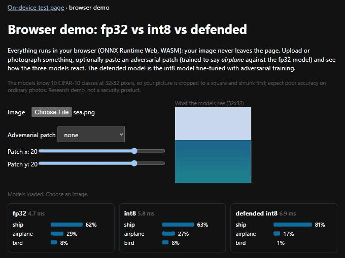
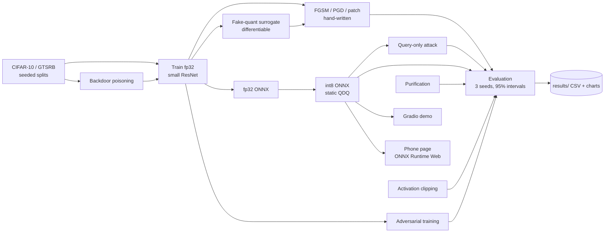
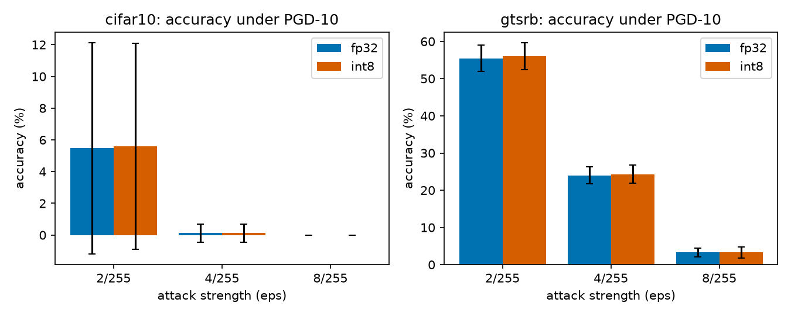
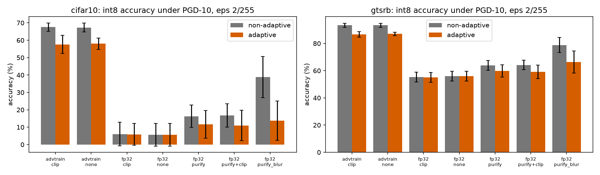
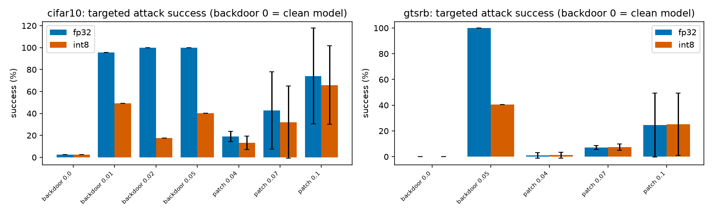

# Secure TinyML: Attacking and Defending Quantized Models

**Do small image classifiers get easier or harder to attack when they are squeezed to int8 for a phone or microcontroller, and which cheap defenses actually help?** This repo measures it: FGSM, PGD, adversarial patches and a backdoor, against fp32 and int8 versions of the same tiny ResNet, with three defenses, a Gradio demo and an in-browser phone test.

- **Browser demo (live):** https://nathaniel47.github.io/secure-tinyml/demo.html runs the fp32, int8 and defended int8 models side by side in your browser (ONNX Runtime Web) with pre-computed adversarial patches; upload or photograph an image. Nothing leaves your device.
- **Phone test page (live):** https://nathaniel47.github.io/secure-tinyml/ loads the int8 or fp32 model and, from a laptop over Wi-Fi, checks agreement with the laptop (see [DEPLOY.md](DEPLOY.md)).
- **Gradio demo (Python version):** not hosted. Run it locally (below). Hugging Face's free tier no longer hosts Gradio Spaces without a PRO subscription (see [DEPLOY.md](DEPLOY.md)).
- **Write-up:** [docs/technical-writeup.md](docs/technical-writeup.md). **Plain-English notes per step:** [LEARNING.md](LEARNING.md). **Design:** [PLAN.md](PLAN.md).



_Demo recording (`docs/demo.gif`) uses a synthetic image, not a dataset image: with the patch pasted on, fp32 and int8 flip from ship to airplane while the adversarially trained model stays on ship._

Small models, small images, one toolchain: this is a study, not a claim about production edge devices. No dataset images are in the repo.

## What it does



The model that is attacked is the model that ships: the same int8 `.onnx` file is evaluated in Python and loaded in the browser. FGSM and PGD are written by hand and cross-checked against the Adversarial Robustness Toolbox (identical for FGSM, within 0.2 points for PGD).

## Results

CIFAR-10 and GTSRB, 3 training seeds, 500 test images per grid, mean of 3 seeds (95% intervals in [LEARNING.md](LEARNING.md), "Step 6"). Attack strengths are L-infinity eps in 1/255, 10-step PGD.

| | CIFAR-10 | GTSRB |
|---|---|---|
| Clean accuracy, fp32 / int8 | 81.7% / 81.7% | 97.2% / 97.1% |
| Accuracy under PGD eps 4, fp32 / int8 | 0.1% / 0.1% | 24.0% / 24.3% |
| Attacks that fool fp32 and also fool int8 | 99.9-100% | 98-100% |
| Query-only attack on int8, eps 4 | 56% accuracy | 73% accuracy |
| Patch covering 10% of the image, success on fp32 / int8 | 74% / 66% (huge seed spread) | 25% / 25% |
| Backdoor, 5% poison, success on fp32 / int8 (one seed) | 100% / 40% | 100% / 40% |
| Adversarial training: accuracy under *adaptive* PGD eps 4 | 0.1% to 45.9% (clean 81.7% to 69.9%) | 24.3% to 69.9% (clean 97.1% to 96.5%) |
| Input purification, adaptive PGD eps 4 | about 0% (helps only non-adaptive attackers) | 24.3% to 28-36% (small, uncertain) |
| Activation clipping | no effect | no effect |





What it means, briefly:
- int8 neither protects against nor adds to adversarial vulnerability here; attacks crafted on fp32 carry over almost completely, and the query-only attack is far weaker than white-box, so int8 is not hiding its gradients.
- Adversarial training is the only defense that clearly works, including against an attacker who knows about it. A defense is only counted if it survives that adaptive attacker.
- A planted backdoor survives int8 only partly (17-49% on CIFAR-10, 40% on GTSRB) with unchanged clean accuracy. One seed per rate: suggestive, not established.
- Along the way a 7-point int8 accuracy loss turned out to be an ONNX Runtime kernel setting (uint8 activations saturate), not quantization itself ([LEARNING.md](LEARNING.md), "Step 4b").

## Run locally (laptop: tests and demo, no GPU)

Windows (PowerShell):
```powershell
py -3.11 -m venv .venv
.venv\Scripts\Activate.ps1
pip install -r requirements-dev.txt
pytest
python app/demo.py
```

macOS / Linux:
```bash
python3.11 -m venv .venv
source .venv/bin/activate
pip install -r requirements-dev.txt
pytest
python app/demo.py
```

`app/assets/` (models and patches) is committed, so the demo runs as is; example images are not committed (licences), upload your own. Rebuild assets after retraining with `python app/make_assets.py`. The browser page needs `python web/make_testset.py`, then see [DEPLOY.md](DEPLOY.md) for the Wi-Fi phone test.

Docker: `docker compose up` serves the demo on http://localhost:7860.

### Reproduce the results (needs torch; about 8 hours of laptop CPU, or use Kaggle/Colab)

```bash
pip install -r requirements-ml.txt
python -m securetinyml.data.fetch && python -m securetinyml.data.prepare
bash run_queue.sh      # trains every model (resumes from checkpoints)
bash run_grids.sh      # attack and defense grids, aggregation, charts
```

## Data

```bash
python -m securetinyml.data.fetch      # CIFAR-10 (170 MB) and GTSRB (365 MB) into data/raw
python -m securetinyml.data.prepare    # cache arrays, make seeded train/val splits (seeds 0-2)
python -m securetinyml.data.report     # writes results/data_report.md
```

Raw data, cached arrays and split indices are gitignored; `data/split_digests.json` holds a hash per split so a rebuilt split can be checked. GTSRB is split by physical sign (track) so near-identical frames never straddle the split. PlantVillage is not downloaded (no stable direct link, licence unverified). See [results/data_report.md](results/data_report.md).

## Dataset licences and terms

Checked 2026-11-18. **None of these gives an authoritative, machine-readable licence I could confirm; treat all as research use and do not redistribute the raw data.**

| Dataset | Source used | What the official page says | Status |
|---|---|---|---|
| CIFAR-10 | cs.toronto.edu/~kriz/cifar.html | Asks users to cite the Krizhevsky 2009 tech report. No licence text on the page. Third-party tables say MIT or "unknown". Images were crawled from the web (subset of 80M Tiny Images). | Research use, cite. Archive md5 matched `c58f30108f718f92721af3b95e74349a`. |
| GTSRB | ERDA mirror linked from the INI benchmark repo (the old benchmark.ini.rub.de site now redirects to github.com/houbensebastian/GermanTrafficSignBenchmarks) | Asks to cite Stallkamp et al., IJCNN 2011 and Neural Networks 2012. No licence stated (the repo has none). A Hugging Face mirror says GPL-3.0, which is not the authors' statement. | Research use, cite. No checksum published; sha256 prefixes printed by `fetch`. |
| PlantVillage | not downloaded | Conflicting: CC0 1.0 (Mendeley record per Meta-Album) vs CC BY-SA 3.0 (a Zenodo copy, one paper). Official Mendeley page not opened. | **Unverified.** Decide before using it. |

Code licence: MIT, see [LICENSE](LICENSE) (code only; the datasets have their own terms and are not included).

## Limitations

- **Scale:** 3 seeds and 500 images per grid, so intervals are wide; backdoor results are one seed per rate; one tiny ResNet (about 0.15M parameters) at 32x32, trained briefly on a CPU.
- **Attack strength:** 10-step PGD with no restarts and no AutoAttack, so every robust number is an upper bound. The adaptive attack on purification is BPDA (straight-through gradient); a cleverer one may do better. The query-only attack is a simplified random search, not the published Square Attack. The patch and backdoor are not cross-checked against ART.
- **Quantization:** one toolchain (ONNX Runtime static int8, min/max calibration); the fake-quant surrogate is not QAT; a TFLite cross-check was not attempted; one result depends on a kernel setting.
- **Defenses:** adversarial training is the cheap one-step version at one eps (4/255); activation clipping used one cap (99.9th percentile) and may need tuning.
- **Device:** on one Android phone (Chrome, WASM) and one desktop browser the in-browser models matched the laptop on 200 of 200 images; phone latency was 8.5 ms (int8) and 7.2 ms (fp32) per image, so int8 gave no speed-up there. One phone, one run; WebGPU and the Raspberry Pi were out of scope.
- **Not done:** PlantVillage, backdoor detection, hosted demo.
- **Data:** dataset licences are unverified (above).

## Future work

More phones and repeated latency runs; AutoAttack and stronger adaptive attacks; quantization-aware training and a second int8 toolchain (TFLite, on Colab); more seeds for the backdoor result and a test of why int8 weakens it; tuned activation clipping and full PGD adversarial training on a GPU; backdoor detection (activation clustering); PlantVillage; larger models.
